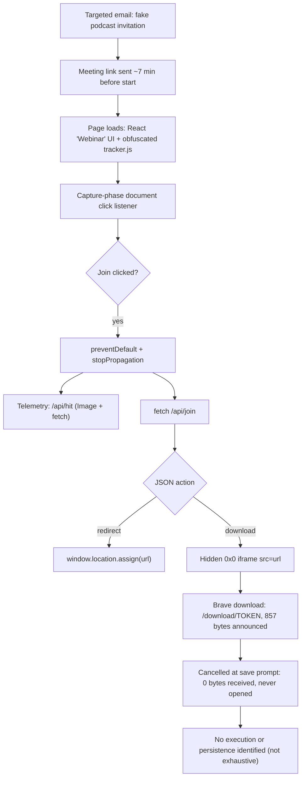

# Fake StreamYard Meeting: Linux Browser Phishing Forensic Analysis

> **Warning:** This repository documents live attacker infrastructure. All indicators are
> defanged (`hxxps`, `[.]`). Do not visit them. No malicious payload, raw attacker
> JavaScript, or browser database is published here.

## Research summary

In October 2026, a security researcher running **Linux Mint** with **Brave (Flatpak)** received a
targeted invitation to appear on a crypto-security "podcast". On the recording day, the sender
supplied a "StreamYard" join link hosted on a look-alike subdomain:

```
hxxps://streamyard[.]host12us[.]com/meeting/<redacted-meeting-id>
```

The page imitated a webinar waiting room. Statically decoding its obfuscated `tracker.js` shows
that clicking **Join** is intercepted, reported to the server (`/api/hit`), and followed by a
request to `/api/join` whose JSON response tells the page either to **redirect** the browser or
to load a URL in a **hidden iframe** to start a download.

Brave's history database recorded exactly one download from the site: a
`/download/<token>` URL, announced as 857 bytes, **cancelled by the user at the save prompt with
0 bytes received and never opened**. A review of common Linux persistence locations, processes,
and network state found no confirmed malicious activity.

**Successful compromise was not demonstrated.** Equally, this investigation was not a full disk
or memory examination, so it cannot prove the absence of all malicious activity.

## High-level findings

| # | Finding | Confidence |
|---|---------|------------|
| 1 | The lure was a **targeted** fake podcast invitation, written from the target's public posts, with the meeting link delivered minutes before the "recording". | Observed |
| 2 | The site impersonated StreamYard (title `StreamYard Webinar`) on `streamyard.host12us[.]com`, not on StreamYard's own domain. | Confirmed |
| 3 | `tracker.js` hides its strings behind a rotated, custom-alphabet Base64 string table; static decoding recovered 14 decoder aliases, 204 decoder calls, and 89 literal concatenations. Reproduced byte-for-byte. | Confirmed |
| 4 | A capture-phase click listener intercepts **Join**, sends telemetry to `/api/hit`, and asks `/api/join` for a server-chosen `redirect` or `download` action. | Confirmed (code) |
| 5 | The `download` action loads the server-supplied URL in an invisible iframe. | Confirmed (code) |
| 6 | Brave recorded a cancelled download (`state=2`, `interrupt_reason=40`, `received_bytes=0`, `opened=0`) from `/download/<token>`, initiated from the meeting tab. | Confirmed |
| 7 | That download was produced by the `download` branch of `/api/join`. | Inferred (the JSON response was not recovered) |
| 8 | The operator likely saw the click in near real time via `/api/hit`; a "coming? waiting for you" message arrived about a minute after the cancelled download. | Inferred |
| 9 | Neither JavaScript sample references wallet providers, clipboard writes, cookies, or storage APIs. | Confirmed (static search) |
| 10 | No malicious persistence or payload execution identified in the reviewed locations. | Observed (researcher-reported; not exhaustive) |
| 11 | The payload's content, type, and target platform. | **Unknown** |

## Attack flow



The full diagram, with confidence colouring, is in [`diagrams/attack-flow.mmd`](diagrams/attack-flow.mmd).

## Forensic methodology

1. **Offline only.** The suspicious domain and its `/api/*` and `/download/*` endpoints were not
   requested during analysis. Page resources came from a public
   [urlscan.io scan](docs/evidence-and-limitations.md#sources) captured while the site was live.
2. **Static JavaScript analysis.** The gzip-encoded urlscan response bodies were decompressed and
   checked against their SHA-256 hashes. Strings were recovered with Python text processing:
   string-table rotation was solved arithmetically, decoder calls were replaced with literals, and
   adjacent literals were folded with `ast.literal_eval`. No JavaScript was executed. See
   [`docs/javascript-deobfuscation.md`](docs/javascript-deobfuscation.md).
3. **Browser forensics.** Brave's `History` and `DIPS` SQLite files were copied, hashed, and queried
   from scratch copies using `mode=ro&immutable=1`. Only incident-related rows were extracted.
4. **Host review.** Processes, sockets, user/system services, timers, cron, autostart entries,
   and selected filesystem locations were reviewed live by the researcher.

## Evidence summary

| Artifact | Kind | Provenance | Published here? |
|----------|------|------------|-----------------|
| `index-DTuBtXUO.js` (main React bundle) | Attacker JavaScript | urlscan.io archive; SHA-256 verified | No: hash and short excerpts only |
| `tracker.js?v=8` | Attacker JavaScript | urlscan.io archive; SHA-256 verified | No: hash and reconstructed pseudocode |
| urlscan `result.json` | Public scan metadata | urlscan.io | No: relevant fields summarised |
| Brave `History` (copy) | Browser database | Researcher's profile | No: one download record and three visits summarised |
| Brave `DIPS` + WAL (copy) | Browser database | Researcher's profile | No: match counts only |
| Email thread | Lure | Supplied by the researcher | No: sanitised summary |
| Linux review | Live triage | Reported by the researcher | No raw output was preserved |
| Filesystem timeline | — | The file exists but is empty | Not available |

## Outcome and confidence

- **Confirmed:** the site delivered a server-directed download mechanism, and Brave recorded a
  download attempt that was cancelled with **0 bytes received** and **not opened**.
- **Not established:** payload execution, persistence, credential or wallet theft, data
  exfiltration, or browser sandbox escape. None of these are claimed.
- **Residual risk:** the payload was never obtained, the `/api/join` response was not recovered,
  and no memory or full-disk analysis was done. Cancelling a download greatly reduces risk but
  **does not by itself guarantee** that nothing else happened.

## Documentation

| Document | Contents |
|----------|----------|
| [Incident timeline](docs/incident-timeline.md) | Sanitised, source-tagged timeline |
| [Threat model](docs/threat-model.md) | Attacker goals, target profile, security boundaries |
| [Technical analysis](docs/technical-analysis.md) | End-to-end walkthrough (the 15 key questions) |
| [JavaScript deobfuscation](docs/javascript-deobfuscation.md) | Obfuscation scheme, decoding, reconstructed control flow |
| [Browser forensics](docs/browser-forensics.md) | `History` and `DIPS` analysis |
| [Linux persistence review](docs/linux-persistence-review.md) | What was checked, and how to repeat it |
| [Security recommendations](docs/security-recommendations.md) | Browser, wallet, Linux, and incident-response guidance |
| [Evidence and limitations](docs/evidence-and-limitations.md) | Hashes, provenance, confidence model, unverified items |
| [Responsible disclosure](docs/responsible-disclosure.md) | Where to report this infrastructure |
| [Publication checklist](docs/publication-checklist.md) | Privacy review performed before release |
| [Indicators](indicators/iocs.md) · [hashes](indicators/hashes.sha256) | IoCs (defanged) and verified hashes |
| [Tools](tools/README.md) | Hash-gated static decoders and a read-only Chromium download query |

## Ethical use

This repository is for defensive research, detection, and education. Do not use it to rebuild,
host, or improve phishing infrastructure. Do not interact with the listed indicators outside an
isolated environment that you are authorised to use. See [SECURITY.md](SECURITY.md).

## Authors

Research and write-up: **0xOucan** (the targeted researcher). Analysis and drafting were assisted by
**Claude** (Anthropic), which is credited as co-author in the commit history.

The sender persona named in [`indicators/iocs.md`](indicators/iocs.md) may be an impersonator using
someone else's name, or a person who does not exist. We do not know at this point.

## License

Documentation is under CC BY 4.0 and code in `tools/` is under the MIT License. See [LICENSE](LICENSE).
