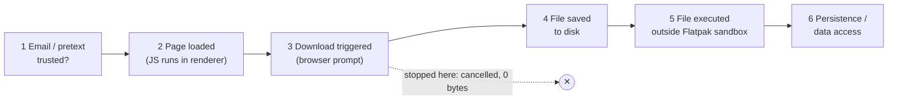

# Threat Model

## Target profile (sanitised)

The target was a public crypto and hardware-wallet security researcher. Public posts showed a
long-standing interest in self-custody and active work on wallet hardware. People with this
profile are attractive targets because they may hold digital assets, have signing devices, run
privileged developer environments, and have influential accounts. (Observed, generalised)

## Likely attacker objectives

| Objective | Evidence | Confidence |
|---|---|---|
| Get the target to run attacker-supplied software ("use our application") | Page text; `download` action; download record | Confirmed (mechanism), Inferred (intent) |
| Learn whether and when the target clicks | `/api/hit` telemetry with per-meeting code | Confirmed (code) |
| Keep the lure away from scanners | `/denied.html` gate; server-side action selection; no payload URL in client code | Confirmed (code), Inferred (intent) |
| Gather personal media (portrait, logos) | Repeated photo requests in the emails | Observed. Purpose Unknown; it could support later impersonation. |
| Wallet theft or credential theft | No supporting evidence in the recovered page code or host review | **Not established** |

The overall pattern (fake interview or podcast → fake meeting site → "download our meeting app")
fits social-engineering campaigns against cryptocurrency professionals that have been reported
publicly. This report does **not** attribute the incident to any named actor.

## Security boundaries

Each stage below is a separate barrier. Getting past one does not mean the attacker got past the
next.

This incident is **confirmed through stage 3**. The record shows it stopped there (no bytes saved,
never opened). The host review found no sign of stages 5–6.

### Downloads: two different controls

| Control | What it prevents | What it does **not** prevent |
|---|---|---|
| "Ask where to save each file" or blocking automatic downloads | Silent saving of files | The page **triggering** a download prompt |
| No automatic opening or execution of downloads | Files running without a deliberate user action | The user choosing to run the file later |

The researcher reports both controls were in place (**Reported**; browser `Preferences` were not
exported). The empty `target_path` and the cancellation at the save prompt are consistent with an
"ask where to save" style prompt. (Inferred)

### Wallet extensions: five separate boundaries

The researcher reports that browser wallet extensions were set to **restricted site access**, so
they run on a site only after an explicit user action (**Reported**).

| # | Boundary | Who controls it | What the attacker gains if crossed |
|---|---|---|---|
| 1 | Extension **installed** | User | Nothing by itself |
| 2 | Extension **permitted to run** on this site (site access) | User, through the browser's extension settings | The extension's content script and injected provider can run on the page |
| 3 | Site **detects** a wallet | Page JavaScript | Knows the visitor probably holds crypto, which helps target follow-ups |
| 4 | User **connects** the wallet to the site | User approves in the wallet UI | Public addresses and the ability to *request* signatures |
| 5 | User **approves a signature or transaction** | User, in the wallet or on a hardware device | Assets can move |

Key points:
- Restricting site access (boundary 2) usually stops an extension from **injecting its provider**
  (for example `window.ethereum`) into pages until you allow it. That removes the easiest detection
  method and every connection request.
- It is **not** a guarantee against **detection** (boundary 3). Depending on the extension and the
  browser, a site may still infer an installed extension through web-accessible resources, timing,
  or other fingerprinting side channels. Do not assume a site *cannot* know a wallet is installed.
- Boundaries 4 and 5 always need explicit user approval. A hardware signer adds an independent
  screen and button confirmation.
- In this incident, the recovered page code made **no** attempt at boundaries 3–5 (Confirmed by
  static search). The server could still have chosen a `redirect` to a different page that did, so
  restricted site access is still a useful protection.

## Assumptions and non-goals

- This report does not assess the security of Brave, Chromium, Flatpak, or any wallet product.
- No browser zero-day, sandbox escape, or arbitrary command execution is claimed or suggested by
  the evidence.
